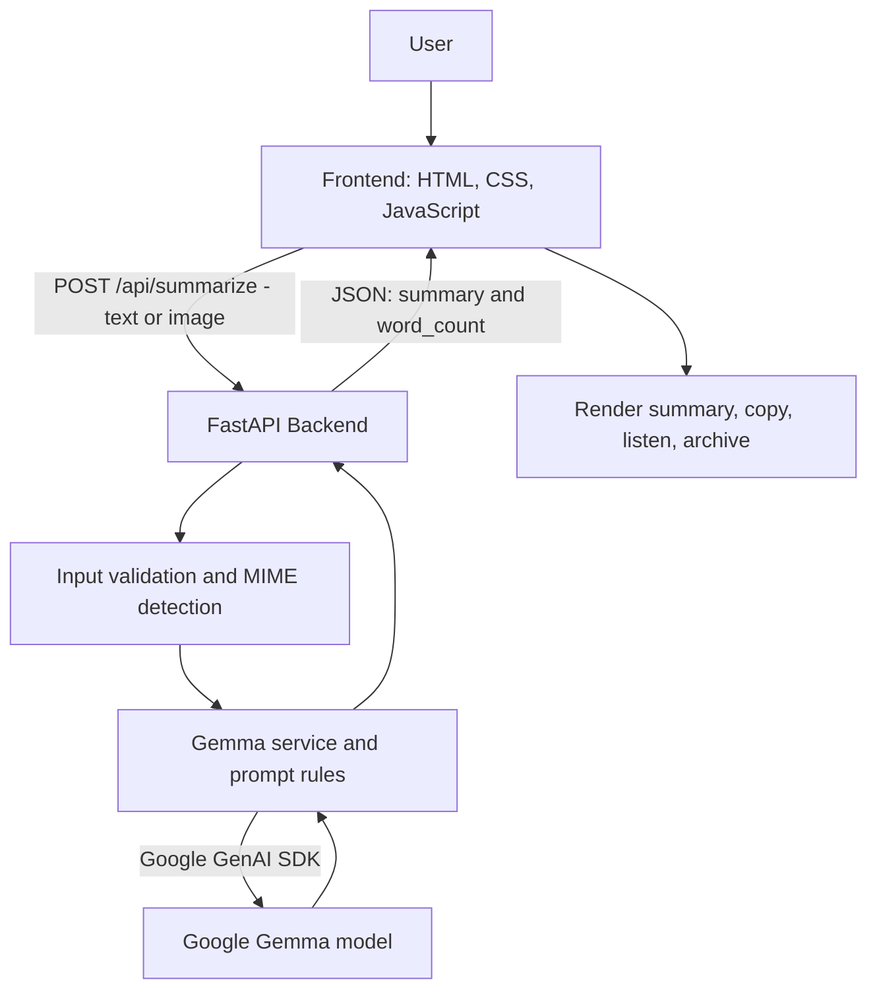

# NewsIn60 📰

**Turn long news articles into clear, concise summaries in seconds.**

NewsIn60 is a lightweight AI-powered news summarizer. Users can paste a news article or upload an image containing news text and receive a concise summary in simple English. The project uses a browser-based frontend, a FastAPI backend, and Google's Gemma model through the Google GenAI SDK.

## Features

- **Text summarization:** Paste long-form news text and generate a concise summary.
- **Image summarization:** Upload a supported image containing readable news text.
- **Simple-language output:** Prompts guide the model to produce an easy-to-understand, single-paragraph summary.
- **Word count:** Displays the word count of the generated summary.
- **Listen and Copy:** Listen to the summary using browser speech synthesis or copy it to the clipboard.
- **Archive:** Keep and revisit summaries within the current browser session.
- **Input validation and error handling:** Handles missing input, unsupported image types, oversized uploads, and upstream AI service errors.

## Architecture



### Request flow

1. The user pastes article text or selects an image in the frontend.
2. The frontend sends the input as `multipart/form-data` to `POST /api/summarize`.
3. FastAPI validates the input and checks image content/type and upload size.
4. The Gemma service builds the summarization prompt and calls the configured Google model.
5. The backend returns a JSON response containing the summary and its word count.
6. The frontend displays the result and provides copy, listen, and archive controls.

### Main components

| Component | Responsibility |
|---|---|
| `frontend/index.html` | Newspaper-inspired interface, input handling, API requests, and summary display |
| `backend/main.py` | FastAPI application, API endpoints, request validation, and error handling |
| `backend/gemma_service.py` | Calls the configured Gemma model through the Google GenAI SDK |
| `backend/prompts.py` | Summarization instructions and output constraints |
| `backend/requirements.txt` | Python dependencies for the backend |

## Tech Stack

- **Frontend:** HTML, CSS, JavaScript
- **Backend:** Python, FastAPI, Uvicorn
- **AI model integration:** Google GenAI SDK and Gemma
- **API format:** HTTP, JSON responses, and multipart form uploads
- **Browser features:** Clipboard API and Speech Synthesis API

## Prerequisites

- Python 3.10 or newer (Python 3.12 has been used during development)
- A Google AI Studio API key with access to the configured model
- A modern web browser

## Setup and Run Locally

### 1. Clone the repository

```bash
git clone https://github.com/ishita526/News-in-60.git
cd News-in-60
```

### 2. Create and activate a virtual environment

**Windows PowerShell:**

```powershell
py -m venv venv
.\venv\Scripts\Activate.ps1
```

If PowerShell blocks activation, you can use the environment's Python executable directly in the commands below.

### 3. Install backend dependencies

```powershell
.\venv\Scripts\python.exe -m pip install -r backend\requirements.txt
```

### 4. Configure the API key

Create a `.env` file in the project root:

```env
GOOGLE_API_KEY=your_google_ai_studio_api_key
```

Replace the placeholder with your own key. **Never commit `.env` or expose your API key in frontend code.**

Make sure `.env` is listed in `.gitignore`.

### 5. Start the backend

From the project root, run:

```powershell
.\venv\Scripts\python.exe -m uvicorn main:app --app-dir backend --reload --port 8000
```

The backend should be available at `http://127.0.0.1:8000`.

Health check:

```powershell
curl.exe -i http://127.0.0.1:8000/health
```

Interactive API documentation (when the backend is running): `http://127.0.0.1:8000/docs`

### 6. Start the frontend

Open a second terminal:

```powershell
cd frontend
python -m http.server 8080
```

Open `http://127.0.0.1:8080` in your browser.

Keep both servers running while using the app.

## API Reference

### `GET /health`

Checks whether the backend is running.

Example response:

```json
{
  "status": "ok"
}
```

### `POST /api/summarize`

Accepts `multipart/form-data` with one of these fields:

| Field | Type | Description |
|---|---|---|
| `text` | String | News article text to summarize |
| `image` | File | Image containing news text |

Example success response:

```json
{
  "summary": "The generated news summary appears here.",
  "word_count": 98
}
```

The word count above is illustrative. The actual value depends on the generated summary.

The API validates input and may return an HTTP error for missing/invalid input, unsupported image formats, oversized files, rate limits, or upstream service failures.

## Security Notes

- Store the Google API key in a root-level `.env` file.
- Keep `.env`, virtual environments, and Python cache files out of version control.
- Never put the API key in `frontend/index.html` or any other client-side file.
- If an API key is accidentally committed or shared, revoke it and create a replacement.

## Current Scope and Limitations

- Summary quality depends on the input and the configured model.
- Image summarization depends on the image containing sufficiently clear, readable news text.
- The archive is stored in browser-session memory and is not a permanent, account-based database.
- The frontend's duration, tone, and category controls should only be described as affecting the AI output if they are explicitly connected to backend behavior.

## Future Improvements

- Connect summary length and tone options to backend prompt parameters.
- Add persistent, user-controlled summary history.
- Add automated backend and frontend integration tests.
- Deploy the frontend and backend with secure environment-variable configuration.

## License

No license has been specified yet. Add a `LICENSE` file if you intend to define how others may use, modify, and distribute this project.
